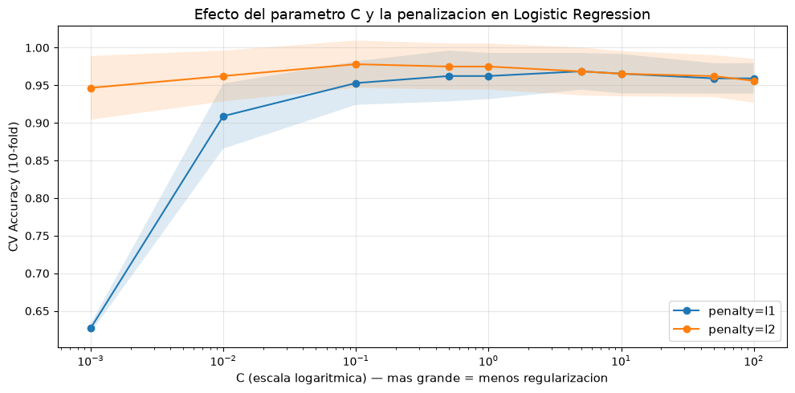

# Breast Cancer Classification: ML Pipeline

Clasificación de tumores de mama (**benigno / maligno**) a partir de 30 características morfológicas de núcleos celulares, comparando modelos clásicos, *boosting* y *ensembles* con validación cruzada estratificada.

Proyecto de la asignatura *Data Analytics* (Ingeniería en IA, TECNUN – Universidad de Navarra, curso 2025-26). Las predicciones se evaluaban sobre un conjunto de test oculto en una tabla de clasificación de la clase.

## Problema

- **Dataset:** 569 muestras, 30 features numéricas (radio, textura, perímetro, área, concavidad… en sus versiones *mean*, *se* y *worst*).
- **Train:** 319 muestras etiquetadas (200 B / 119 M).
- **Test:** 250 muestras con `diagnosis` vacío. Son las que se predicen y se entregan.
- **Métrica:** *accuracy*.

## Enfoque

1. **Preprocesamiento:** imputación por mediana + `StandardScaler` para los modelos sensibles a la escala (SVM, LR, KNN).
2. **Comparación de modelos** con `StratifiedKFold` de 10 folds: Random Forest, XGBoost, SVM (RBF), Regresión Logística y KNN.
3. **Ensembles:** *Soft Voting* de los 5 modelos y *Stacking* con meta-learner logístico.
4. **Ajuste de la Regresión Logística** con `GridSearchCV` sobre `C` y la penalización (L1/L2), dentro de un `Pipeline` (imputer → scaler → modelo) para evitar *data leakage* entre folds.
5. Entrenamiento final con todo el train y exportación de predicciones a CSV.

## Resultados (CV estratificada, 10 folds)

| Modelo | Accuracy media | Desv. típica |
|---|---|---|
| **Regresión Logística ajustada** (C=0.1, L2) · *pipeline* | **0.978** | 0.031 |
| Regresión Logística (C=1.0) | 0.975 | 0.031 |
| Soft Voting Ensemble | 0.972 | 0.026 |
| KNN (k=5, distancia) | 0.959 | 0.042 |
| Stacking Ensemble | 0.956 | 0.040 |
| Random Forest (500 árboles) | 0.953 | 0.041 |
| XGBoost | 0.950 | 0.038 |
| SVM RBF (C=10) | 0.950 | 0.053 |

> En el notebook 01 el escalado se ajusta sobre todo el train antes de la CV, así que su cifra para la LR (0.975) puede ser algo optimista. El notebook 02 lo hace dentro del `Pipeline`, y su *baseline* equivalente da 0.972.

**Conclusión:** con pocas muestras y features muy informativas (y bastante correlacionadas), un modelo lineal bien regularizado gana a los modelos más complejos. Una regularización moderada (`C=0.1`, L2) es la que mejor generaliza. El *Soft Voting* tiene la menor varianza entre folds.



## Estructura

```
├── data/
│   └── data_breast_cancer_red.csv        # train etiquetado + test sin etiqueta
├── notebooks/
│   ├── 01_ensemble_pipeline.ipynb        # comparación de modelos + voting + stacking
│   └── 02_logistic_regression_tuning.ipynb  # GridSearch de LR con Pipeline
├── outputs/
│   ├── predictions_ensemble.csv          # predicciones del mejor modelo del notebook 01
│   └── predictions_logreg.csv            # predicciones de la LR ajustada
├── assets/
└── requirements.txt
```

## Cómo ejecutarlo

```bash
git clone https://github.com/amarcalainm-oss/breast-cancer-ml-pipeline.git
cd breast-cancer-ml-pipeline
python -m venv .venv
.venv\Scripts\activate          # Windows  (Linux/macOS: source .venv/bin/activate)
pip install -r requirements.txt
jupyter notebook notebooks/
```

Probado con Python 3.14, scikit-learn 1.9, XGBoost 3.4 y pandas 3.1.

## Datos

Basado en el [Breast Cancer Wisconsin (Diagnostic) Dataset](https://archive.ics.uci.edu/dataset/17/breast+cancer+wisconsin+diagnostic) (UCI Machine Learning Repository, licencia CC BY 4.0). Es una versión preparada para la asignatura, con las etiquetas del test ocultas.

## Tecnologías

Python · pandas · NumPy · scikit-learn · XGBoost · Matplotlib · Jupyter
